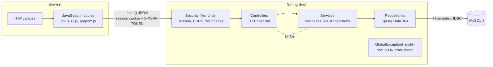
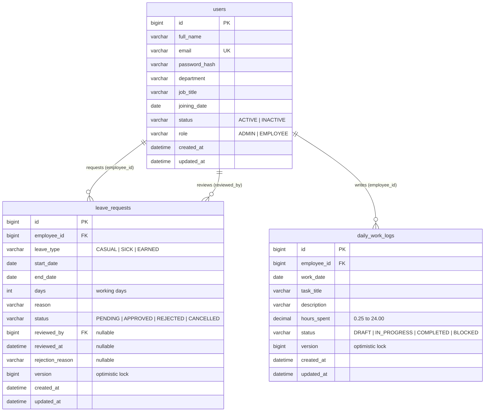

# WorkTrack

**Employee management and leave tracking for small and medium-sized teams.**
Administrators manage people and decide leave requests. Employees send requests and follow the decision. Everything is a real Spring Boot application talking to MySQL: nothing on screen is hard-coded.

Built as a portfolio project for Java Full Stack roles, so the code favours clarity over cleverness and every rule is written down.

---

## Contents

1. [Features](#features)
2. [Technology stack](#technology-stack)
3. [Architecture](#architecture)
4. [Database design](#database-design)
5. [Business rules (leave policy)](#business-rules-leave-policy)
6. [Daily Work Tracker](#daily-work-tracker)
7. [Security design](#security-design)
8. [Prerequisites](#prerequisites)
9. [MySQL setup](#mysql-setup)
10. [Configuration](#configuration)
11. [Build and run](#build-and-run)
12. [Initial administrator](#initial-administrator)
13. [Tests](#tests)
14. [API overview](#api-overview)
15. [Project structure](#project-structure)
16. [Screenshots](#screenshots)
17. [Verification status](#verification-status)
18. [Production database changes](#production-database-changes)
19. [Known limitations and future improvements](#known-limitations-and-future-improvements)
20. [E-mail notifications](#e-mail-notifications)
21. [Dashboard analytics and exports](#dashboard-analytics-and-exports)
22. [Audit log](#audit-log)
23. [Continuous integration and deployment](#continuous-integration-and-deployment)

More documentation: [`docs/api-documentation.md`](docs/api-documentation.md) (every endpoint with examples), [`docs/WorkTrack.postman_collection.json`](docs/WorkTrack.postman_collection.json) (import into Postman), [`docs/request-flow-and-interview-questions.md`](docs/request-flow-and-interview-questions.md) (how a click becomes a database row, plus interview questions based on this code).

---

## Features

**For everyone**
- Sign in and out with a secure server-side session.
- Light and dark theme, responsive layout (desktop, tablet, phone), keyboard friendly with visible focus.
- Change your own password.

**Employees**
- Dashboard with profile summary, request counts (total, pending, approved, rejected) and recent history.
- Send a leave request (casual, sick or earned) with a live "working days" preview.
- See the status of each request, read a rejection reason, cancel a pending request.
- List or month-calendar view of their own leave.
- **My analytics** on the dashboard (hours per day, tasks by status) and CSV / Excel export of their own reports.
- **Daily work** (Daily Work Tracker): log several tasks per day (date, title, description, hours, status), keep private drafts, edit entries, delete drafts, filter and search their history and see hours per day and for any date range.

**Everyone**
- **E-mail notifications** to the employee when a leave request is submitted, approved or rejected (see [E-mail notifications](#e-mail-notifications)).

**Administrators**
- **Email queue** page (delivery status, attempts, last error, retry of failed messages) and **Audit log** page (who did what, when, with what outcome).
- **Dashboard analytics:** charts of reported hours, daily reporting coverage and task status; **CSV / Excel export** of work reports.
- Dashboard: total and active employees, pending, approved and rejected requests (all calculated by database queries), who is away today, people per department, and a queue of requests waiting for a decision.
- Employees: create, view, edit, deactivate; search by name or email; filter by department and status; sortable, server-side pagination.
- Leave: approve or reject (a reason is required to reject); filter by status, employee and date; list view or a team calendar showing who is away on each day.
- Their own requests live under the **Mine** switch. Another administrator has to decide them.
- **Work reports** (Daily Work Tracker): team reports with hours, task progress and summary cards; filter by employee, date range and status; search by employee name or task title; open any report in full; a **Missing reports** view that lists who has not reported on which working day (weekends and approved leave are skipped).

---

## Technology stack

| Layer | Technology |
|---|---|
| Front end | HTML5, CSS3, vanilla JavaScript (ES modules, `fetch`). No framework, no CSS library, no inline styles. Fonts are self-hosted. |
| Back end | Java 17, Spring Boot 3.5, Spring Web (REST), Spring Data JPA, Hibernate, Spring Security, Bean Validation |
| Database | MySQL 8.x |
| Mail | Spring Boot Mail (Jakarta Mail). `log` mode by default, `smtp` mode when configured. |
| Build | Maven |
| Tests | JUnit 5, Mockito, Spring Boot Test, MockMvc, Spring Security Test. Integration tests use in-memory H2 (test scope only) so they need no MySQL server. Testcontainers (MySQL 8) tests run migrations and a concurrent claim on a real MySQL when Docker is available and are skipped otherwise. |

The front end is kept in the top-level `frontend/` folder; Maven copies it into the backend jar at build time and Spring Boot serves it, so the page and the API share one origin: no CORS configuration is needed.

---

## Architecture



| Package (`com.worktrack`) | Responsibility |
|---|---|
| `controller` | Read the request, call one service method, return a DTO and a status code. No business logic. |
| `service` | All rules (leave policy, self-approval ban, overlap checks) and `@Transactional` boundaries. |
| `repository` | Spring Data interfaces and `Specification` builders for filters. |
| `entity` | JPA entities `User` and `LeaveRequest`, plus enums. |
| `dto` | Records for every request and response. Entities are never serialised, so no password hash can leak and there is no infinite recursion. |
| `security` | `UserDetails`, JSON 401/403 handlers, CSRF handler, per-request "is this account still active" filter. |
| `config` | `SecurityConfig`, the clock bean, first-administrator initialiser. |
| `exception` | Typed exceptions and `GlobalExceptionHandler`. |

---

## Database design



**How accounts and employees relate.** There is a single `users` table. One row is both the login account (email, password hash, role) and the employee profile (name, department, job title, joining date, status). They are the same record, so nothing is duplicated and an account can never disagree with its employee data. The Employee ID shown in the UI (`EMP-0001`) is derived from the primary key.

**Relationships.** `leave_requests.employee_id` points at the person the leave is for; `leave_requests.reviewed_by` points at the administrator who decided it. The relationship is one-directional in code (a leave knows its employee; an employee does not hold a list of leaves).

**Indexes and constraints.** Unique email; indexes on department, status and role for the employee filters; indexes on `(employee_id, status)`, `status` and `(start_date, end_date)` for the leave lists, and `(employee_id, status, start_date, end_date)` for the overlap check and the annual total.

**Schema management.** The tables are created and upgraded by **Flyway** when the application starts, using the versioned scripts in [`database/migrations`](database/migrations) (`V1` = the initial schema, `V2` = the overlap index, `V3` = the daily work tracker table). Hibernate only *validates* that the entities match the tables (`DDL_AUTO=validate`). [`database/schema.sql`](database/schema.sql) is a readable snapshot of the final schema for manual setup and review. A database created by an older version of this project (by Hibernate `update` or by `schema.sql`) is *baselined* at version 1, so nothing is dropped or re-created. See [Production database changes](#production-database-changes).

---

## Business rules (leave policy)

| Rule | Behaviour |
|---|---|
| Leave days | Only **Monday to Friday** count. Saturdays and Sundays are not counted. Public holidays are not modelled, so they count as working days. |
| Date order | The end date cannot be before the start date. |
| Past dates | Casual and earned leave must start **today or later**. Sick leave may be **backdated up to 7 days**. |
| Limits | One request covers at most 60 calendar days and starts at most 365 days from today. |
| Weekend-only | A request whose dates are all on a weekend is rejected (it would use 0 days). |
| Overlap | A new request may not overlap the same employee's **pending or approved** requests (409). Approval re-checks overlap against **approved** requests. |
| Deciding | Only **pending** requests can be approved or rejected. Rejecting needs a reason. The reviewer and the time are stored. |
| Self-review | Nobody can approve or reject their own request, administrators included (403). |
| Cancelling | Only the owner can cancel, and only while pending. |
| Concurrency | Two administrators deciding the same request at once: one succeeds, the other gets 409 (optimistic locking). |
| Deactivating an employee | The record and leave history stay. The person can no longer sign in (existing sessions stop at the next request), and their pending requests are cancelled, in one transaction. |
| Guard rails | An administrator cannot deactivate themselves or remove their own admin role. |

---

## Daily Work Tracker

Employees report what they worked on each day; administrators monitor the reports. It uses the two roles WorkTrack already has (ADMIN and EMPLOYEE). **No manager role was added**: a manager role needs a reporting hierarchy (who manages whom) and its own permission checks, and half-building that would have been less secure than not having it. Administrators therefore see every employee's reports. If you later need per-team managers, the clean extension is a `manager_id` on `users` plus an ownership check in `WorkLogService`.

**Pages.** *Daily work* (employees) and *Work reports* (administrators) appear in the sidebar (`/work.html`). Both dashboards have a "last 7 days" work card.

**How to use it**
- *Employee:* open **Daily work** → **Log work** → pick the date, name the task, describe it, enter hours (0.25 steps) and a status → **Save entry**. Add as many entries per day as you need. Use **Draft** for something you are still writing: drafts are private, are not counted as hours or as a reported day, can be edited and are the only entries that can be deleted. Change the status to publish it. Use the range buttons (Today, This week, This month, Last 30 days) or the date fields; the cards and the "Hours per day" bars follow the same range. Filter by status and search by task title.
- *Administrator:* open **Work reports**. **Team reports** shows summary cards and hours by employee for the range (click a name to filter), plus the full list; filter by employee, status and dates, search by employee name or task title, and open **View** to read a full description. **Missing reports** lists employees with working days that have no submitted report. **My entries** is the administrator's own log.

**Rules (enforced on the server; the forms only mirror them)**

| Rule | Detail |
|---|---|
| Owner | Always the signed-in user. There is no employee id in any create or "my" request; an `employeeId` in a body is ignored. |
| Who can change an entry | Only its author can edit or delete it. Administrators can read submitted entries but cannot edit or delete anyone's entry. |
| Drafts | Private to the author. Not shown in any administrator list or summary and not readable by administrators (403). Not counted as hours or as a submitted day. |
| Delete | Drafts only (a submitted entry gives 409). |
| Date | Not in the future; not more than 30 days back (checked on create and when the date is changed). |
| Hours | 0.25 to 24 per entry, at most 2 decimals, and at most **24 hours per person per day across all entries** (including drafts). Creating and editing lock the author's row, like leave submission, so simultaneous requests cannot exceed the cap. |
| Text | Title 3-150 characters, description 5-2000 characters, status one of DRAFT, IN_PROGRESS, COMPLETED, BLOCKED. |
| Missing report | A weekday from the employee's joining date up to **yesterday** (today is still open) with no submitted entry and no APPROVED leave. Only active employees with the EMPLOYEE role are checked. Range at most 62 days. **Public holidays are not modelled**, so a company holiday shows as missing. |
| Ranges | Summaries accept at most 366 days; the default range is the last 7 days. |

**Endpoints** (details in [`docs/api-documentation.md`](docs/api-documentation.md))

| Method and path | Who | Purpose |
|---|---|---|
| `POST /api/work-logs` | signed in | Create an entry (author = session user) |
| `GET /api/work-logs/my` | signed in | Own entries: `status`, `from`, `to`, `q`, paging, `sortBy` (`id`, `workDate`, `hoursSpent`, `status`, `taskTitle`, `createdAt`) |
| `GET /api/work-logs/my/summary` | signed in | Own totals and per-day hours for `from`/`to` |
| `GET /api/work-logs` | admin | All submitted entries: also `employeeId`; `q` matches task title or employee name |
| `GET /api/work-logs/summary` | admin | Team totals, status counts and hours per employee (`from`, `to`, `employeeId`) |
| `GET /api/work-logs/missing` | admin | Employees with missing reports (`from`, `to`, `employeeId`) |
| `GET /api/work-logs/{id}` | owner, or admin for submitted entries | One entry |
| `PUT /api/work-logs/{id}` | owner | Edit |
| `DELETE /api/work-logs/{id}` | owner, drafts only | Delete |

**Database migration.** `V3__daily_work_logs.sql` adds one table, `daily_work_logs` (foreign key to `users`, indexes on employee+date, date and status, CHECK constraints for status and hours). It uses `CREATE TABLE IF NOT EXISTS` and touches nothing else, so existing users and leave requests are unaffected. To upgrade an existing installation: **back up the database**, replace the application, and start it. Flyway applies V3 automatically (the log shows "Migrating schema `worktrack` to version 3"). The Flyway account needs `CREATE` (see [Production database changes](#production-database-changes)). To check: `SHOW CREATE TABLE daily_work_logs;`. Rolling back means `DROP TABLE daily_work_logs;` and deleting the V3 row from `flyway_schema_history`; there is no automatic undo.

---

## Security design

- **Authentication:** Spring Security, email + password, passwords stored as **BCrypt** hashes. The login response never contains a password or hash.
- **Sessions:** server-side session; the browser only holds an opaque cookie (`WORKTRACK_SESSION`) that is `HttpOnly`, `SameSite=Lax` and, **by default, `Secure`** (HTTPS only; the CSRF cookie too). The session id is carried only in the cookie, never in a URL. Nothing sensitive is in `localStorage` (only the theme name). The session id is regenerated at login (session-fixation defence). Sessions expire after 30 minutes of inactivity. **Changing or resetting a password ends all other sessions of that person**, and the session that made the change gets a new id.
- **Sign-in throttling:** wrong passwords are counted per *IP address + typed email* and per IP. After 5 failures that pair is locked for 1 minute, then 2, 4, 8... up to 15 minutes (HTTP 429 with `Retry-After`); one IP trying many emails is stopped after 30 failures. The response is the same whether or not the email exists, and the real owner is not locked out by somebody else's guesses from another address. The same counter protects the "current password" check of the change-password form. Limits are configurable (`LOGIN_*` variables). The counters are in memory (see limitations).
- **CSRF protection is ON.** Spring sets an `XSRF-TOKEN` cookie; `api.js` copies it into the `X-XSRF-TOKEN` header on every `POST`, `PUT`, `PATCH` and `DELETE`. Requests without it get 403.
- **Authorisation is enforced on the server** in three layers: URL rules in `SecurityConfig` (run before any request body is read, so a non-admin always gets 403), `@PreAuthorize` on the controllers, and checks inside the services for "own record only" rules. Hiding a menu item in JavaScript is a convenience, never the security boundary.
- **Deactivation, role changes and password changes take effect immediately:** a filter re-checks the account (status, role, password fingerprint) in the database on every API request.
- **Concurrency:** submitting and approving leave lock the employee's row (`SELECT ... FOR UPDATE`, `READ_COMMITTED`) so two simultaneous requests cannot both pass the overlap check; `@Version` still protects two admins deciding the same request.
- **Consistent errors:** 400 validation, 401 not signed in, 403 not allowed, 404, 409 conflict; always the same JSON shape. Login failures use one generic message so accounts cannot be probed.
- **Input safety:** Bean Validation on every request body; sort fields come from an allow-list; filters use JPA parameters (no string-built SQL); `LIKE` wildcards typed by users are escaped.
- **Browser hardening:** strict Content-Security-Policy (`script-src 'self'`, no inline script or style), `frame-ancestors 'none'`, `X-Content-Type-Options: nosniff`, same-origin referrer policy, `Permissions-Policy`, `Cross-Origin-Opener-Policy` / `Cross-Origin-Resource-Policy: same-origin`, `Cache-Control: no-store`, HSTS on HTTPS responses. No CORS is enabled (page and API share one origin). All front-end rendering escapes data before it reaches `innerHTML`.
- **Passwords:** 8-72 characters with a letter and a number, and at most 72 *bytes* (BCrypt's real limit; longer is a clear 400).
- **No secrets in source:** the database password has no default; the first administrator comes from environment variables.

---

## Prerequisites

- **JDK 17** or newer (the project targets Java 17)
- **Maven 3.9+**
- **MySQL 8.x**
- A modern browser

Check: `java -version`, `mvn -v`, `mysql --version`.

---

## MySQL setup

Open a MySQL shell as an administrator (`mysql -u root -p`) and run:

```sql
CREATE DATABASE worktrack CHARACTER SET utf8mb4 COLLATE utf8mb4_0900_ai_ci;

CREATE USER 'worktrack_app'@'localhost' IDENTIFIED BY 'choose-a-strong-password';
GRANT ALL PRIVILEGES ON worktrack.* TO 'worktrack_app'@'localhost';
FLUSH PRIVILEGES;
```

Use that password as `DB_PASSWORD` below. The application creates the tables itself on first start (Flyway). That user therefore needs `CREATE`, `ALTER` and `INDEX` as well as `SELECT, INSERT, UPDATE, DELETE`; for production see [Production database changes](#production-database-changes).

---

## Configuration

All settings come from environment variables (or a git-ignored `.env` file). **Nothing secret is stored in source control.**

1. Go into the backend folder (`cd backend`) and copy the template: `cp .env.example .env` (Windows PowerShell: `Copy-Item .env.example .env`)
2. Edit `.env`: set `DB_PASSWORD`, `WORKTRACK_ADMIN_EMAIL`, `WORKTRACK_ADMIN_PASSWORD`.
3. Start the app from `backend/`, the folder that contains `.env` and `pom.xml`.

| Variable | Default | Purpose |
|---|---|---|
| `DB_HOST` / `DB_PORT` / `DB_NAME` | `localhost` / `3306` / `worktrack` | MySQL location |
| `DB_USERNAME` | `worktrack_app` | MySQL user |
| `DB_PASSWORD` | **none (required)** | MySQL password. Startup fails until you set it. |
| `DB_SSL_MODE` | `PREFERRED` | Use `REQUIRED` or `VERIFY_CA` for a remote database |
| `DDL_AUTO` | `validate` | Hibernate only checks the schema. Leave it unset; Flyway makes the changes. |
| `SPRING_FLYWAY_USER` / `SPRING_FLYWAY_PASSWORD` | the DB user | Optional separate, more privileged account used only to run migrations |
| `WORKTRACK_ADMIN_EMAIL` / `_PASSWORD` / `_NAME` | none | First administrator, see below |
| `SERVER_PORT` | `8080` | HTTP port |
| `SESSION_COOKIE_SECURE` | **`true`** | Cookies are HTTPS-only by default. `.env.example` sets `false` for plain-HTTP local development; **delete that line in production**. |
| `FORWARD_HEADERS_STRATEGY` | `none` | Set `native` behind a reverse proxy that terminates HTTPS, so the real client IP (login throttling) and HTTPS (HSTS) are seen. Leave `none` otherwise, because the header can be faked by direct clients. |
| `LOGIN_MAX_FAILURES` / `LOGIN_MAX_FAILURES_PER_IP` | `5` / `30` | Failures before a lock for one IP+email / for one IP |
| `LOGIN_WINDOW_MINUTES` / `LOGIN_BASE_LOCK_SECONDS` / `LOGIN_MAX_LOCK_MINUTES` | `15` / `60` / `15` | Counting window, first lock length (doubles each time), longest lock |

**Local development without HTTPS.** Keep `SESSION_COOKIE_SECURE=false` in your `.env` (copied from `.env.example`). Chrome and Firefox also accept `Secure` cookies on `http://localhost`, but Safari does not, which is why the example file turns it off.

**Production checklist.** Serve the app only over HTTPS (reverse proxy such as nginx or a cloud load balancer); remove `SESSION_COOKIE_SECURE=false` (the default `true` applies); set `FORWARD_HEADERS_STRATEGY=native` if a proxy is in front; keep `DDL_AUTO` unset; store `DB_PASSWORD` and `WORKTRACK_ADMIN_PASSWORD` in the platform's secret store, not in a file in the repository; use `DB_SSL_MODE=REQUIRED` for a remote database; set the host time zone (the app uses the server's clock for "today").

You can also export real environment variables instead of using `.env`:

```bash
# macOS / Linux
export DB_PASSWORD='choose-a-strong-password'
export WORKTRACK_ADMIN_EMAIL='you@example.com'
export WORKTRACK_ADMIN_PASSWORD='a-long-passphrase-here'
```

```powershell
# Windows PowerShell
$env:DB_PASSWORD = 'choose-a-strong-password'
$env:WORKTRACK_ADMIN_EMAIL = 'you@example.com'
$env:WORKTRACK_ADMIN_PASSWORD = 'a-long-passphrase-here'
```

---

## Build and run

```bash
cd backend

# run directly from source
mvn spring-boot:run

# or build a jar and run it
mvn clean package
java -jar target/worktrack-1.0.0.jar
```

Open <http://localhost:8080> and sign in with the administrator you configured.

---

## Initial administrator

There is no default account and no credential in the code. On startup, **only if no ADMIN exists**, WorkTrack creates one from `WORKTRACK_ADMIN_EMAIL` and `WORKTRACK_ADMIN_PASSWORD` (at least 12 characters; the `change-me...` placeholder is refused). The password is BCrypt-hashed and never logged. Once an administrator exists these variables are ignored, so you can delete them from `.env`.

After signing in, add people under **Employees → Add employee**. Give each person a temporary password (there is a generator button); they can change it on **My profile**.

---

## Tests

```bash
cd backend
mvn test            # all tests
mvn clean package   # compiles, runs the tests, builds the jar
```

| Kind | Classes | What they cover |
|---|---|---|
| Unit (Mockito, fixed clock) | `LeaveServiceTest` | date range, past-date policy, weekend-only, 60-day limit, overlap, working-day count, approve/reject, self-approval ban, cancel rules, viewing rules, **lock-before-check order in submit and approve** |
| Unit | `EmployeeServiceTest` | creation (trim, lower-case, BCrypt, defaults), duplicate email, admin lock-out guard, deactivation cancels pending leave, own-profile rule, password change |
| Unit | `LeaveDayCalculatorTest`, `PageRequestsTest`, `EmployeeSpecificationsTest` | weekend maths, **clipping a request to a calendar year (December-January, previous-year start, weekend-only, outside the year)**, safe pagination and sort allow-list, `LIKE` escaping |
| Integration (MockMvc, real security, H2 in MySQL mode) | `AuthIntegrationTest` | login, wrong password, unknown email, inactive account, 401 without session, CSRF enforced, logout, deactivated session stops, password change, BCrypt storage |
| Integration | `EmployeeIntegrationTest` | CRUD, validation, duplicates, search/filter/pagination/sort, bad parameters, safe delete, **employee 403 on admin endpoints**, **employee cannot read another employee** |
| Integration | `LeaveIntegrationTest` | submit, invalid date range, past dates, empty body, overlap (409), **own-requests scoping**, **cannot open another employee's request**, admin filters, approve/reject, self-review ban, **overlap at approval time**, cancel rules, CSRF |
| Integration | `DashboardIntegrationTest` | admin counts match the database, admin dashboard forbidden to employees, employee dashboard is personal, **annual days clip requests that cross New Year (both directions) and skip weekends**, **deactivated employees are not "away today" but their leave record stays** |
| Integration | `LeaveConcurrencyIntegrationTest` | four simultaneous overlapping submissions create exactly one request; two admins approving two overlapping requests approve exactly one; two admins approving the same request: one 200, one 409 |
| Integration | `LoginThrottlingIntegrationTest` | lock after 5 failures with `Retry-After`, identical behaviour for unknown and known emails, other addresses not locked, success resets, validation errors not counted, change-password guessing throttled |
| Integration | `SecurityIntegrationTest` | security headers, HSTS, cookie defaults, session-id rotation, **password change / reset / demotion end sessions**, **every protected endpoint 401 without a session**, **every admin endpoint 403 for an employee (work-log endpoints included)**, **every write 403 without a CSRF token**, mass-assignment ignored, employee isolation, 72-byte password limit, no internals or hashes in responses |
| Unit (Mockito, fixed clock) | `WorkLogServiceTest` | owner taken from the session, trimming, 2-decimal hours, **lock-before-check order**, future / 30-day date rules, **24-hour day cap** (exactly 24 allowed), inactive account, owner-only edit and delete (administrators refused), old entries keep their date, drafts-only delete, **drafts private from administrators**, summaries, range limits, **missing days** (weekends, approved leave, joining date, submitted days, today, future end) |
| Integration | `WorkLogIntegrationTest` | create and ownership (employee id in body ignored), field validation, date window, 24-hour cap (also **under concurrency**), my list scoping / filters / paging / sort allow-list / `%` search, my summary (drafts excluded), **other employees get 403 on read, edit, delete**, administrator is read-only, edit and delete rules, **employees get 403 on team list, summary and missing**, team list hides drafts, team summary, missing reports (leave, drafts, admins, inactive, joining day, today), deactivated employee locked out |
| Unit | `SpreadsheetSafeTest`, `CsvWriterTest`, `XlsxWriterTest` | formula-injection prefixing, CSV quoting / BOM / CRLF, XLSX package structure, cell types, column names, 32 767-character cap |
| Unit | `BackoffTest`, `ErrorSanitizerTest`, `EmailTemplatesTest`, `SmtpEmailSenderTest` | exponential back-off and cap, secrets / addresses removed from stored errors, HTML escaping in templates, permanent vs temporary SMTP errors (mocked mail sender, no real SMTP) |
| Unit (Mockito) | `NotificationDispatcherTest`, `NotificationServiceTest`, `AuditServiceTest`, `AnalyticsServiceTest` | claim / send / mark order, retry with back-off, permanent failure, attempts exhausted, lost claim, queuing rules and dedupe, audit redaction and failure handling, analytics ranges and coverage rules |
| Integration | `NotificationIntegrationTest` | queued rows for submit / approve / reject, mail failure does not undo a decision, invalid address skipped, expired-lease recovery, double claim, admin retry (409 / 403 / CSRF / audit), queue API hides message bodies |
| Integration | `AuditIntegrationTest`, `AnalyticsIntegrationTest`, `WorkLogExportIntegrationTest` | audit rows for login / logout / business events, no secrets stored, admin-only read, no write endpoints; analytics isolation, drafts excluded, ranges; CSV / XLSX content, BOM, formula neutralising, filters, scoping, 401 / 403 / 400 |
| MySQL (Testcontainers, needs Docker) | `FlywayMySqlMigrationTest`, `MySqlApplicationIntegrationTest` | clean migrate, upgrade from V2 keeping data, baseline of a pre-Flyway database, application start with `ddl-auto=validate`, 8 threads racing for one notification |
| Unit | `LoginAttemptLimiterTest` | lock thresholds, doubling and cap, scoping to IP+email, per-IP limit, window expiry, memory bound (fixed clock) |

Integration tests use the `test` profile (`src/test/resources/application-test.properties`) with an in-memory H2 database, so you do not need MySQL to run them.

---

## API overview

Base URL `http://localhost:8080`. All bodies are JSON. State-changing calls need the CSRF header (see [Security design](#security-design)). Full details and examples: [`docs/api-documentation.md`](docs/api-documentation.md).

| Method and path | Who | Purpose |
|---|---|---|
| `POST /api/auth/login` | public | Sign in |
| `POST /api/auth/logout` | signed in | Sign out (ends the session) |
| `GET /api/auth/me` | signed in | Current person |
| `POST /api/auth/change-password` | signed in | Change own password |
| `GET /api/employees` | admin | List with `q`, `department`, `status`, `page`, `size`, `sortBy`, `direction` |
| `GET /api/employees/departments` | admin | Department names for filters |
| `GET /api/employees/{id}` | admin, or the person themselves | One employee |
| `POST /api/employees` | admin | Create |
| `PUT /api/employees/{id}` | admin | Update (optional password reset) |
| `DELETE /api/employees/{id}` | admin | Deactivate (soft delete) |
| `POST /api/leaves` | signed in | Send a request |
| `GET /api/leaves/my` | signed in | Own requests (filters, paging) |
| `GET /api/leaves` | admin | All requests (`status`, `employeeId`, `from`, `to`, paging) |
| `GET /api/leaves/{id}` | owner or admin | One request |
| `PATCH /api/leaves/{id}/cancel` | owner | Cancel while pending |
| `PATCH /api/leaves/{id}/approve` | admin (not own) | Approve |
| `PATCH /api/leaves/{id}/reject` | admin (not own) | Reject, body `{ "reason": "..." }` |
| `GET /api/dashboard/admin` | admin | Numbers, queue, who is away |
| `GET /api/dashboard/employee` | signed in | Personal numbers and history |

The nine `/api/work-logs` endpoints are listed under [Daily Work Tracker](#daily-work-tracker).

Two small additions beyond the brief: `GET /api/auth/csrf` (makes sure the CSRF cookie exists before a first `POST`) and `POST /api/auth/change-password`.

---

## Project structure

```
WorkTrack/
├── README.md
├── .gitignore
├── backend/                          Spring Boot application (run Maven from here)
│   ├── pom.xml
│   ├── .env.example                  environment template (copy to backend/.env)
│   └── src/
│       ├── main/java/com/worktrack/  controller, service, repository, entity, dto, security, config, exception, util
│       ├── main/resources/           application.properties
│       └── test/java/com/worktrack/  util, repository, service (unit) and integration tests
├── frontend/                         vanilla HTML/CSS/JS, served by the backend
│   ├── index, login, dashboard, employees, employee-form, leaves, work, profile (.html)
│   ├── css/                          app.css (design system), login.css
│   ├── js/                           api.js, ui.js, shell.js, forms.js, leave-actions.js, work-actions.js, theme.js, pages/*.js
│   └── fonts/                        self-hosted Bricolage Grotesque and Instrument Sans (SIL OFL)
├── database/
│   ├── schema.sql                    readable snapshot of the final schema
│   └── migrations/                   Flyway migrations (V1, V2, V3, ...)
└── docs/
    ├── api-documentation.md
    ├── WorkTrack.postman_collection.json
    └── request-flow-and-interview-questions.md
```

`backend/pom.xml` copies `../frontend` (as `static/`) and `../database/migrations` (as `db/migration/`) onto the classpath, so `mvn clean package` still produces one self-contained jar and the page and API keep a single origin. Structural choices that differ from the brief's sketch: `util/` holds the leave-day calculator and the safe-pagination helper; the front end has shared modules (`api.js`, `ui.js`, `shell.js`, `forms.js`, `leave-actions.js`, `work-actions.js`) so each page script stays short; fonts are bundled instead of loaded from a CDN (works offline, and the Content-Security-Policy can stay strict).

---

## Screenshots

Add **genuine** screenshots of your running copy here. No images are included on purpose, so nothing in this README shows something that was not actually running.

1. Start the app with some sample employees and leave requests.
2. Capture: sign-in page, admin dashboard, employees list, leave list, leave calendar, employee dashboard, mobile view.
3. Save them in `docs/screenshots/` (for example `admin-dashboard.png`) and reference them:

```markdown

```

---

## Verification status

Be explicit about what has and has not been run:

| Item | Status |
|---|---|
| Front end in a real browser (Chromium): sign-in, both dashboards, employee list/filter/create/deactivate, leave request/approve/reject/cancel, calendar, profile, light/dark, phone width, strict Content-Security-Policy, and the "too many sign-in attempts" banner | **Exercised** against a throw-away stand-in API that mimics the response shapes (not the Spring backend) |
| `LeaveDayCalculator` year clipping and `LoginAttemptLimiter` (compiled with `javac` and run with a small throw-away harness: 9 and 23 checks) | **Executed, all passed.** The JUnit versions of these checks (`LeaveDayCalculatorTest`, `LoginAttemptLimiterTest`) have not been run. |
| Flyway `V1` / `schema.sql` syntax | **Parsed** as MySQL with a SQL parser (syntax only). `V2` (conditional `PREPARE`) could not be parsed by that tool and has **not** been run on MySQL. |
| `mvn clean test` (before the Daily Work Tracker was added) | **Second real run (user's Windows machine, Java 17.0.18, H2): 133 tests, 131 passed, 2 failed.** All integration classes passed (Auth 12, Dashboard 5, Employee 13, LeaveConcurrency 3, Leave 18, LoginThrottling 6) plus the unit tests, except: `SecurityIntegrationTest.csrfCookieAttributes` (MockMvc did not show `SameSite` in the `Set-Cookie` header; assertion now also reads the cookie attribute) and `EmployeeServiceTest.changePasswordStoresHash` (test still expected `save`, code uses `saveAndFlush`; test updated). **Both fixes are untested until you re-run.** `mvn clean package` not run. |
| **Daily Work Tracker** backend (entity, repository queries, service, controller, V3 migration) and its tests (`WorkLogServiceTest`, `WorkLogIntegrationTest`, the extended `SecurityIntegrationTest` and `IntegrationTestBase`) | **Written, not compiled with Maven, not run.** Checked only by a `javac` syntax pass and by hand. Maven Central is blocked in the authoring sandbox. HQL in the new repository (aggregates with interface projections, `(:employeeId = -1 or ...)`) is the most likely place for a first-run error. Run `mvn clean test` and send any failure. |
| **Daily Work Tracker** front end (`work.html`, `work.js`, `work-actions.js`, dashboard cards, sidebar) | **Exercised in Chromium** against the throw-away stand-in API (not the Spring backend): employee and admin flows, form validation, server error banner, draft delete, edit, search, missing view, 420-px-high window (buttons stay reachable), phone width in dark mode (no horizontal scroll), employee 403 on admin endpoints. |
| `V3__daily_work_logs.sql` on MySQL | **Not run.** Check that Flyway reports "Migrating schema `worktrack` to version 3" and that `ddl-auto=validate` still passes. |
| Real MySQL (Flyway, locking, `validate`) | **Partly verified:** the user's `mvn spring-boot:run` against MySQL 8.0.42 validated 3 migrations, found schema version 2 up to date, and Hibernate `validate` passed. Row-lock behaviour under real concurrency on MySQL (the tests use H2) is still not verified. |

| **Enhancement phase** (notifications + outbox, audit log, dashboard analytics, CSV / Excel export, MySQL Testcontainers tests, CI) | **Written, not compiled with Maven, not run** in the authoring sandbox (Maven Central is blocked and there is no Docker). Verified by execution only: the CSV / XLSX writers (output opened with openpyxl and LibreOffice) and JavaScript syntax (`node --check`). Everything Spring / JPA / JUnit, `V4` / `V5` on MySQL and the CI workflow are **unverified until you run `mvn clean test` and `mvn clean package`** (and push to GitHub for CI). |

Record your own result here after running:

```
mvn clean package   ->  (paste the "Tests run: ..., Failures: ..." summary and BUILD result)
```

---

## Production database changes

- Hibernate only validates (`DDL_AUTO=validate`, the default). **Flyway** owns every schema change.
- A new, empty database is created automatically on first start by `V1__initial_schema.sql` and the later scripts.
- For every later change (new column, new index) add a new file `database/migrations/V4__short_description.sql`, never edit one that has been applied (Flyway stores a checksum and refuses to start if it changed), and update `database/schema.sql` in the same commit so it stays the readable snapshot.
- An existing database that was created by an older version (Hibernate `update` or `schema.sql`) is baselined at version 1 on first start; later migrations are written to be safe if the change already exists.
- Back up before the first start of a new version against production data. Migrations are not automatically reversible.
- Least privilege: run migrations with a separate account (`SPRING_FLYWAY_USER` / `SPRING_FLYWAY_PASSWORD`, needs `CREATE, ALTER, INDEX`) and give `DB_USERNAME` only `SELECT, INSERT, UPDATE, DELETE`.
- Tests never touch your database: the `test` profile uses an in-memory H2 database with its own URL.
- Serve the app over HTTPS; secure cookies are on by default (see the production checklist above).

---

## Known limitations and future improvements

- **Sign-in throttling is in memory.** Counters reset on restart and are not shared between several instances. Behind a proxy without `FORWARD_HEADERS_STRATEGY=native` every user looks like the same IP, so the per-IP limit would be shared. For several instances use a shared store or an API gateway rule.
- **Leave submission and approval use a row lock per employee.** How long a request waits for a lock is set by MySQL (`innodb_lock_wait_timeout`, 50 s by default); a timeout returns a retryable 409. It is safe and deadlock-free (one lock, fixed order) but serialises requests for the same person, which is fine at this scale. Cancelling and rejecting do not need it.
- **No password reset by email.** An administrator can reset a password from the edit form.
- **Public holidays are not modelled**, and leave days are not balanced against an annual allowance.
- **Sessions are in memory**, so they are lost on restart and not shared between several instances. Use Spring Session (JDBC or Redis) to scale out.
- **Daily work reports:** no manager role or team hierarchy (administrators see everyone), public holidays are not modelled for the missing-report check, no comments or approval workflow on reports, and an entry cannot be moved to another employee.
- **Audit log** is append-only by convention (no endpoint changes it) but is **not tamper-proof**: someone with direct database write access can alter it. See [Audit log](#audit-log).
- The calendar loads at most 100 requests per month and says so when it is truncated.
- E-mail is **at-least-once**, and `SENT` means the mail server *accepted* the message, not that it was delivered or read. No push notifications, no per-user opt-out, no bounce handling.
- Dashboard coverage (reporters / active employees) does not subtract leave or public holidays.
- Most tests use H2 (Flyway is disabled there). The real migrations and one real concurrent claim run only in the Testcontainers tests, which need Docker. The leave and work-log row-lock races are still tested on H2 only.
- Dependencies have not been scanned for known vulnerabilities (no network access to a scanner in the authoring sandbox). Run `mvn org.owasp:dependency-check-maven:check` or enable Dependabot.
- Sessions that exist when a password is changed are invalidated on their next request, not instantly pushed out.

---

## E-mail notifications

### What is sent, and to whom

| Event | Recipients | Notes |
|---|---|---|
| Employee created | the new employee | Invitation with a one-time link to choose a password. The password is never e-mailed. One per creation; none if creation fails. |
| Invitation resent (admin button) | the employee | At most one waiting at a time; the older link stops working. |
| Employee profile changed (name, e-mail, department, title, role, joining date) | the employee | Lists what changed. Nothing is sent if nothing changed. A changed address also notifies the previous one. |
| Employee deactivated / reactivated | the employee | Only on a real change of state. |
| Password reset by an admin, role changed | the employee | Security notice. Never contains a password. |
| Password changed by the employee | that employee | Security notice. |
| Leave submitted | **every active administrator with a valid address** (not the submitter) | Names the employee, dates, length and reason, with a link to the leave page. |
| Leave approved / rejected | the employee (rejection includes the reason) | The deciding administrator is not mailed about their own decision. |
| Leave cancelled by the employee | active administrators | Only when the request was already submitted. |

Not implemented, on purpose: daily-work notifications, review/return workflow, missing-report reminders and "leave modified" notices. The application has no manager assignment, no work-log review workflow and no way to edit a submitted leave, so there is nothing to notify about.

### How delivery works (a transactional outbox)

1. The business change and the `notifications` row are written in **one database transaction**. If the change rolls back, so does the message. A duplicate click cannot queue a duplicate (a unique key per recipient and event).
2. A background worker (`NotificationScheduling`, every `NOTIFICATIONS_POLL_MS`) picks due rows, **claims** each with an atomic `UPDATE` (a lease that expires, so a crashed worker's row is picked up again), sends **outside** any transaction, then records `SENT`, schedules a retry, or marks `FAILED`.
3. Temporary errors (timeouts, server busy) are retried with exponential back-off up to `NOTIFICATIONS_MAX_ATTEMPTS`. Permanent errors (bad credentials, invalid address) fail at once. An administrator can retry a `FAILED` message from the **Email queue** page.
4. A mail outage never blocks or undoes a business action. Administrators or employees without a valid address are skipped (logged).
5. The invitation link is created **when the e-mail is sent**, not when it is queued. Only a SHA-256 hash is stored, the link works once, and it expires after `INVITATION_TTL_HOURS` (72). The token sits after `#` in the link so it is not sent in request lines or Referer headers.

Honest limits: delivery is **at least once** (a crash between sending and recording can send the same message twice); `SENT` means the SMTP server accepted it, not that it arrived or was read; stored errors have addresses and configured secrets stripped, but that is a safety net, not a guarantee.

### Why no e-mail arrives: LOG mode

`WORKTRACK_MAIL_MODE` defaults to `log`. In that mode **nothing leaves your computer**; rows in the Email queue show "log only, not delivered". The application prints `E-MAIL IS IN LOG MODE` at startup and the Email queue page shows a red banner. Real e-mail needs `WORKTRACK_MAIL_MODE=smtp` plus the `MAIL_*` settings, and **a restart**: settings are read only at startup.

### Gmail setup (Windows)

1. Turn on 2-Step Verification for the Google account, then create an App Password at https://myaccount.google.com/apppasswords (16 characters). The normal password does not work.
2. In the `backend` folder copy `.env.example` to `.env` and set:
   ```
   WORKTRACK_MAIL_MODE=smtp
   WORKTRACK_MAIL_FROM=your.address@gmail.com
   WORKTRACK_BASE_URL=http://localhost:8080
   MAIL_HOST=smtp.gmail.com
   MAIL_PORT=587
   MAIL_USERNAME=your.address@gmail.com
   MAIL_PASSWORD=your-app-password
   ```
   (Port 587 with STARTTLS is the default. Spaces in the App Password are removed automatically.)
3. Stop the application (Ctrl+C) and start it again from `backend`:
   ```
   mvn spring-boot:run
   ```
   Alternative without a file, PowerShell (this window only): `$env:WORKTRACK_MAIL_MODE="smtp"; $env:MAIL_HOST="smtp.gmail.com"; ...` then `mvn spring-boot:run`. In cmd use `set NAME=value`. `setx` changes only new windows.
4. Check the startup log for `E-mail: SMTP mode. Server smtp.gmail.com:587` and the Email queue banner ("Real e-mail is ON"). The application refuses to start in `smtp` mode without `MAIL_HOST` or a sender. Passwords are never logged.

### Manual test plan

1. Log in as admin. Open **Email queue**: confirm the banner matches your mode.
2. Employees > Add employee with a real address you can read. Expect the toast "An invitation to ... is queued". Within about a minute the Email queue row becomes **Sent** (SMTP) and the mail arrives. Click the link, choose a password, sign in.
3. Click **Resend invitation** twice quickly: only one new row; the earlier link no longer works.
4. As that employee submit a leave request. Every active admin with a valid address gets "New leave request awaiting a decision"; the employee gets nothing about it besides the on-screen result.
5. As an admin approve one request and reject another (with a reason). The employee gets one e-mail each; the rejection shows the reason.
6. Stop the network or use a wrong App Password: rows go to **Pending (will retry)** or **Failed** with a safe error; after fixing, press **Retry**.

---

## Dashboard analytics and exports

- `GET /api/dashboard/employee/analytics` and `GET /api/dashboard/admin/analytics` return aggregates computed with `GROUP BY` queries (nothing is summed in Java). Default period: last 30 days; maximum 366. Drafts are never counted in totals, and the employee view covers only the signed-in user.
- "Hours" are **reported** hours, not verified work. Admin **coverage** = employees who reported / active employees, weekdays only, today excluded from the average; it does not subtract leave or holidays.
- Charts are dependency-free SVG drawn by `frontend/js/charts.js` (CSP-safe, theme-aware).
- Export: `GET /api/work-logs/export` (admin, filters) and `GET /api/work-logs/my/export` (own reports), `format=csv|xlsx`. Streamed in pages; refused before any output if over `EXPORT_MAX_ROWS`. Cells that start with `= + - @` (or tab / CR / LF) are prefixed with `'` so spreadsheets cannot run them as formulas. CSV is UTF-8 with BOM. XLSX is written by a small built-in writer (inline strings only, no formulas, no extra dependency). The admin export never includes drafts; e-mail addresses and password data are never included.

---

## Audit log

`audit_events` records who did what and when: sign-in success / failure / throttling, sign-out, employee create / update / role change / deactivate / password change, leave submit / approve / reject / cancel, work-report create / update / delete / export, notification retry. Each row has the actor, action, entity, outcome (`SUCCESS`, `FAILURE`, `DENIED`), time, client IP, a request id (also returned as `X-Request-Id` and written in the logs) and a short summary.

- Business changes are audited **in the same transaction** as the change. Failed sign-ins and refusals are audited in their own transaction so they survive a rollback.
- Passwords, hashes, session ids and typed-in passwords are never stored (a failed-login label is kept only if it looks like an e-mail address).
- Viewing: administrators only (`GET /api/audit`, **Audit log** page). No endpoint creates, edits or deletes rows.
- **It is append-only by convention, not tamper-proof.** Anyone with write access to the database can change it. For stronger protection, run the application with a database user that has only `SELECT, INSERT` on `audit_events`, for example `REVOKE UPDATE, DELETE ON worktrack.audit_events FROM 'worktrack_app'@'%';`, and ship rows to a write-once store.
- No retention job exists yet; plan one for production.

---

## Continuous integration and deployment

- `.github/workflows/ci.yml` runs on pushes to `main` and on pull requests: JDK 17, Maven cache, `mvn clean test`, then `mvn clean package`, working directory `backend`. GitHub's Ubuntu runners have Docker, so the MySQL Testcontainers tests run there; locally they are skipped when Docker is missing. **This workflow has not been run yet.**
- Deployment checklist: HTTPS in front of the app; remove `SESSION_COOKIE_SECURE=false`; `FORWARD_HEADERS_STRATEGY=native` behind a proxy; real SMTP settings from a secret store; a migration user separate from the runtime user; back up before upgrading; one application instance only unless you move sessions and sign-in throttling to a shared store (the notification worker itself is safe with several instances thanks to the claim).
